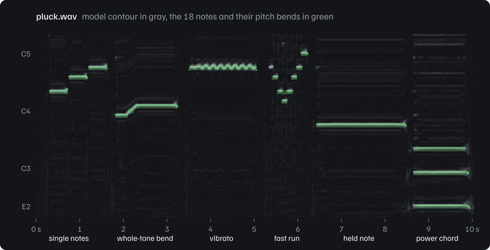

<h1 align="center">basic-pitch-rs</h1>

<p align="center"><em>Audio to MIDI, with pitch bends, in Rust.</em><br />
An unofficial, parity-tested port of Spotify's <a href="https://github.com/spotify/basic-pitch">Basic Pitch</a>: polyphonic note transcription for any instrument or voice, as a library, a command-line tool and a WebAssembly module.</p>

<p align="center">
  <a href="https://athevon.github.io/basic-pitch-rs/"><strong>Try it in your browser</strong></a>
  &nbsp;·&nbsp;
  <a href="#command-line-tool"><strong>Install</strong></a>
  &nbsp;·&nbsp;
  <a href="#library"><strong>Library</strong></a>
  &nbsp;·&nbsp;
  <a href="#parity-with-python"><strong>Parity</strong></a>
  &nbsp;·&nbsp;
  <a href="#performance"><strong>Performance</strong></a>
  &nbsp;·&nbsp;
  <a href="https://docs.rs/basic-pitch-rs"><strong>API docs</strong></a>
  &nbsp;·&nbsp;
  <a href="./CHANGELOG.md"><strong>Changelog</strong></a>
</p>

<p align="center">
  <a href="https://github.com/AThevon/basic-pitch-rs/actions/workflows/ci.yml"></a>
  <a href="https://crates.io/crates/basic-pitch-rs"></a>
  <a href="https://docs.rs/basic-pitch-rs"></a>
  <a href="./Cargo.toml"></a>
  <a href="./LICENSE"></a>
</p>

<p align="center">
  
  <br />
  <sub><code>pluck.wav</code> from the test fixtures, a synthetic guitar take. Gray: the contour posteriorgram the model returns, one row per third of a semitone. Green: the notes the command-line tool writes with its default parameters, and their pitch bends, one value per 11.6 ms frame. Drawn from the tool's JSON and NumPy output by <a href="./reference/render_readme_assets.py"><code>reference/render_readme_assets.py</code></a>.</sub>
</p>

Basic Pitch is a lightweight neural network that turns a recording into notes with pitch
bends, and its reference implementation is a Python package. basic-pitch-rs runs the same
model file and reproduces the post-processing, so a Rust program, a single binary or a
web page gets the same notes, without Python.

- **The same notes as Python.** Every stage is tested against the official
  implementation. From the same samples, the 1650 notes of the test suite are identical:
  frames, times, pitches and pitch bends.
- **Pure Rust by default.** The official model runs on [tract](https://github.com/sonos/tract)
  and is embedded in the binary: no Python, no native library to install.
  [ONNX Runtime](https://onnxruntime.ai) is one feature away.
- **Fast.** 60 s of audio go from samples to notes in 0.19 s with tract on 10 threads,
  about twice as fast as Python's `predict()` on the same machine
  ([details](#performance)).
- **A complete command-line tool.** WAV, AIFF, CAF, FLAC, MP3, Ogg, M4A and MOV inputs,
  gapless AAC decoding (the encoder delay is removed, as ffmpeg does), and MIDI, JSON,
  CSV or NumPy outputs.
- **Runs in the browser.** The library builds for `wasm32-unknown-unknown` without extra
  flags, and the repository has a WebAssembly demo that transcribes files locally.

## Command-line tool

### Install

```sh
cargo install basic-pitch-cli          # builds the `basic-pitch-rs` command
cargo binstall basic-pitch-cli         # or downloads a prebuilt binary
```

The crate is named `basic-pitch-cli`; the command it installs is `basic-pitch-rs`.
Prebuilt binaries for Linux (x86_64, aarch64), macOS (Intel, Apple silicon) and Windows
are attached to each [GitHub release](https://github.com/AThevon/basic-pitch-rs/releases).

### Use

```sh
basic-pitch-rs song.wav                     # writes song_basic_pitch.mid
basic-pitch-rs -o midi/ takes/*.flac        # several files into midi/
basic-pitch-rs riff.m4a --midi --json       # MIDI and JSON notes
basic-pitch-rs riff.m4a --json --output - | jq '.notes[].note_name'
basic-pitch-rs bass.wav --minimum-frequency 30 --maximum-frequency 400
```

| Output | Flag | Content |
| --- | --- | --- |
| MIDI | `--midi` (default) | Written like Python Basic Pitch writes it (pretty_midi): the same notes give the same events |
| JSON | `--json` | Notes sorted by time with note names, velocities and pitch bends, plus the input, model and parameters used. Described by a [JSON Schema](./crates/basic-pitch-cli/schema/transcription.v1.schema.json) |
| CSV | `--csv` | The `--save-note-events` file of Python Basic Pitch, in the same format |
| NumPy | `--posteriorgrams` | The raw model outputs, as float32 arrays in a `.npz` archive |

The note options of the Python tool keep their names and defaults
(`--onset-threshold`, `--frame-threshold`, `--minimum-note-length`,
`--minimum-frequency`, `--maximum-frequency`, `--multiple-pitch-bends`,
`--no-melodia`, `--midi-tempo`, `--save-midi`, `--save-note-events`), plus:

| Option | Effect |
| --- | --- |
| `--bend-offset -1` | Centers the pitch bends of in-tune notes on 0 (see [below](#differences-with-python-basic-pitch)) |
| `--no-infer-onsets`, `--no-pitch-bends` | The remaining switches of the Python library |
| `--trim v0.4.0` | Reproduces the PyPI release exactly, which drops the last frames of each file |
| `-j`, `--threads N` | Model threads (default: one per core); the results do not depend on it |
| `--backend ort` | ONNX Runtime instead of tract (build with `--features ort`) |
| `--resampler soxr` | libsoxr, like librosa (build with `--features soxr`, LGPL-2.1) |

Existing files are never overwritten without `--force`. Exit codes: 0 on success,
1 if an input failed (the others are still processed), 2 for invalid arguments.
`basic-pitch-rs --help` has the details.

## Library

```toml
[dependencies]
basic-pitch-rs = "0.1"
```

```rust
use basic_pitch::{BasicPitch, NoteParams};

fn main() -> Result<(), basic_pitch::Error> {
    // Mono samples at 22 050 Hz: decode and resample your audio first.
    // Here, two seconds of A4 (440 Hz).
    let audio: Vec<f32> = (0..44_100)
        .map(|i| 0.5 * (2.0 * std::f32::consts::PI * 440.0 * i as f32 / 22_050.0).sin())
        .collect();

    let transcriber = BasicPitch::new()?; // loads the bundled model once
    let transcription = transcriber.transcribe(&audio)?;

    for note in transcription.sorted_notes() {
        println!(
            "{:.3} s to {:.3} s  MIDI {}  velocity {}",
            note.start_s, note.end_s, note.pitch, note.velocity()
        );
    }

    let midi: Vec<u8> = transcription.to_midi(&Default::default())?; // a Standard MIDI File

    // Decode the notes again with other parameters, without running the model.
    let centered = transcription.decode_notes(&NoteParams {
        onset_threshold: 0.6,
        bend_offset: -1, // centers the pitch bends of in-tune notes on 0
        ..NoteParams::default()
    })?;
    println!("MIDI file: {} bytes, notes with centered bends: {}", midi.len(), centered.len());
    Ok(())
}
```

The crate is published as `basic-pitch-rs` and imported as `basic_pitch`; this example
runs as a doctest of the crate. Every step of the pipeline is public: windowing,
inference through a `Backend` trait (plug in your own runtime), unwrapping, note
decoding and MIDI export. `BasicPitch` is `Send + Sync`, and `BasicPitch::with_threads`
spreads the model windows over several cores with bit-identical results. See the
[API documentation](https://docs.rs/basic-pitch-rs) and the
[examples](./crates/basic-pitch-rs/examples): `transcribe_file` reads a WAV file and
prints its notes, `posteriorgrams` works with the raw model outputs.

### Features

| Feature | Default | Description |
| --- | --- | --- |
| `tract` | yes | Pure Rust inference with tract; works on `wasm32-unknown-unknown` |
| `bundled-model` | yes | Embeds the official `nmp.onnx` (230 kB) |
| `midi` | yes | Standard MIDI File export |
| `ort` | no | ONNX Runtime backend, about 3 times faster per window. Links an ONNX Runtime 1.31 that you provide; requires Rust 1.92 |
| `ort-download` | no | `ort`, with a prebuilt ONNX Runtime downloaded at build time |
| `serde` | no | `Serialize` and `Deserialize` on the public types |

## How it works

```text
audio, mono 22 050 Hz
  -> windows of 2 s, overlapping by 30 frames          window::windows
  -> neural network, 172 frames per window             model::Backend (tract or ONNX Runtime)
  -> note, onset and contour posteriorgrams            window::unwrap_output
  -> note events with pitch bends                      notes::model_output_to_notes
  -> Standard MIDI File                                midi::note_events_to_midi
```

The constant-Q transform and the harmonic stacking are part of the ONNX graph, so the
Rust side runs the official, unmodified `nmp.onnx` and ports the rest: the windowing,
the stitching of the windows, the note decoding (onset peaks, melodia trick, pitch bends
from the contour) and the MIDI writing of pretty_midi. The command-line tool adds audio
decoding ([symphonia](https://github.com/pdeljanov/Symphonia)) and resampling
([rubato](https://github.com/HEnquist/rubato), or libsoxr like librosa).

| Path | Content |
| --- | --- |
| [`crates/basic-pitch-rs`](./crates/basic-pitch-rs) | The library |
| [`crates/basic-pitch-cli`](./crates/basic-pitch-cli) | The command-line tool: decoding, resampling, output formats |
| [`crates/parity`](./crates/parity) | Parity tests against the Python fixtures (not published) |
| [`examples/wasm`](./examples/wasm) | WebAssembly bindings, browser demo and parity check |
| [`reference`](./reference) | The pinned Python reference, the fixture generators and the Python benchmark |
| [`tests/fixtures`](./tests/fixtures) | Test recordings and the reference output of every stage |

## Parity with Python

Parity here means that each stage, given the same input, returns what the official
Python package returns, compared value by value. The reference is basic-pitch 0.4.0
from PyPI, run with its ONNX model on the CPU, plus the upstream `main` branch for the
one place where they differ. The [Python scripts](./reference) save the output of every
stage on 6 recordings (synthetic tones and guitar, two sung excerpts of the vocadito
dataset, silence, a file shorter than one window), and the
[parity tests](./crates/parity) feed each Rust stage the same input, with 8 parameter
sets and both trim modes:

| Layer | Stage | Result |
| --- | --- | --- |
| L0 | Bundled model | The file of basic-pitch 0.4.0 (SHA-256 checked) |
| L1 | Audio windows | Bit-identical |
| L2 | Model outputs, tract | Within 1.3e-6 of onnxruntime |
| L2 | Model outputs, `ort` backend | Bit-identical on all 29 windows |
| L3 | Unwrapped outputs and frame times | Bit-identical |
| L4 | Notes from Python's model outputs | 1650 of 1650 notes identical: frames, pitches, 41 959 pitch bend values, amplitudes and times to the bit |
| L5 | MIDI files | 96 files, 31 544 events, all identical |
| L6 | Whole pipeline with tract, from samples to notes | 1650 of 1650 notes identical |
| L7 | Adversarial post-processing cases | 17 synthetic cases (ties and plateaus, thresholds at 0 and 1, negative numpy indices, 9000-frame inputs, NaN, extreme tempos): 5252 notes and 47 MIDI files identical, and an error wherever Python raises |

The closest call of L6 is a note activation of vocadito_10 that sits 2.9e-6 from a
threshold, against a tract difference of 8.3e-7: parity of the notes holds on these
recordings, and a value closer to a threshold than about 1e-6 could flip on another
input. The command-line tool is checked end to end as well, from the audio files: 1650
of 1650 notes identical (frames, times, pitches, bends) with either resampler.
Resampling moves amplitudes by up to 2.4e-4, so 2 velocities out of 1650 differ by one
step.

numpy's semantics are reproduced wherever they can change a note: round half to even,
`argrelmax` without plateaus, first-index `argmax`, NaN propagation, float64
intermediates and numpy's pairwise float32 summation.

## Performance

Apple M2 Pro (6 performance and 4 efficiency cores, 16 GB), macOS 27, release builds,
medians, measured on 2026-10-17. Python is basic-pitch 0.4.0 with onnxruntime 1.31.0 on
Python 3.11, timed on the same inputs by
[`reference/bench_python.py`](./reference/bench_python.py); the Rust side is
`cargo bench -p basic-pitch-rs --features ort-download`.

| Task | basic-pitch-rs | Python basic-pitch 0.4.0 |
| --- | --- | --- |
| Load the model | tract: 26 ms<br />`ort`: 10 ms | 11 ms |
| One 2 s model window | tract: 31 ms (one core)<br />`ort`: 9.8 ms | onnxruntime: 9.3 ms (all cores), 32 ms (one core) |
| Note decoding of 12.2 s of audio, from the model outputs | 1.2 ms | 4.6 ms |
| 60 s of audio, from samples to notes, model loaded | tract: 1.15 s on one core, 0.19 s on 10 threads<br />`ort`: 0.37 s | `predict()`: 0.42 s (all cores), 1.23 s (one core) |
| 60 s file, whole command: start, load the model, decode 44.1 kHz stereo, resample, transcribe, write MIDI | 0.31 s (tract, all cores), 1.27 s (one core) | |

On one core, tract runs the model as fast as onnxruntime. With
`BasicPitch::with_threads` (the default of the command-line tool), the windows run in
parallel and 60 s of audio take 0.19 s, about twice as fast as Python's `predict()`,
which runs one window at a time on all cores. The `ort` backend runs at Python's
inference speed, since it is the same runtime, and the note decoding is about 4 times
faster than Python's. A 20 minute file takes 5 s and 0.9 GB of memory with the
command-line tool. Its release binary weighs 19 MB stripped (7.3 MB gzipped), model
included. The library's benchmarks are in
[`crates/basic-pitch-rs/benches`](./crates/basic-pitch-rs/benches).

## WebAssembly

```sh
cargo build --target wasm32-unknown-unknown --no-default-features --features tract,bundled-model
```

No extra flag is needed. [`examples/wasm`](./examples/wasm) has `wasm-bindgen`
bindings, a browser demo (drop a file, see a piano roll, download the MIDI file; the
audio never leaves the page) and a parity check that runs in Node and in browsers. The
module weighs 2.3 MB gzipped, model included, and transcribes about 22 times faster
than real time in Chromium on the machine above. The bindings are an example, not a
published npm package, and only Chromium and Node have been tested.

tract's WebAssembly kernels do not use fused multiply-add, so the model outputs differ
from Python by up to 5e-4 instead of 1e-6 (tract's portable native kernels give the
same difference). On the test recordings, 824 of 825 notes stay identical; the last one
differs by one pitch bend frame.

## Differences with Python Basic Pitch

The defaults reproduce Python, including its quirks. Worth knowing:

- **Pitch bends of in-tune notes read +1** (a third of a semitone), because the
  model's pitch contour peaks one bin high
  ([spotify/basic-pitch#87](https://github.com/spotify/basic-pitch/issues/87)). The
  green lines of the image above sit a third of a semitone high for that reason.
  basic-pitch-rs keeps it for parity; `--bend-offset -1` (or
  `NoteParams::bend_offset = -1`) centers them on 0.
- **The end of each file is kept.** basic-pitch 0.4.0 drops the last frames of
  every file (about 0.4 s per minute); upstream `main` fixed it, and so does the
  default `TrimMode::Main`. `--trim v0.4.0` (`TrimMode::V0_4_0`) reproduces the
  release.
- **ONNX Runtime runs on the CPU.** On macOS, ONNX Runtime can hand part of the graph
  to CoreML, which computes in reduced precision and moves the outputs by up to 0.15.
  The `ort` backend forces the CPU. The Python package itself prefers its CoreML model
  on macOS, so a plain `basic-pitch` run on a Mac is not the ONNX reference either (see
  [`reference/README.md`](./reference/README.md)).
- **Inputs that Python cannot handle are errors.** A negative frame threshold makes
  the Python decoder loop forever; it is rejected. Notes that cannot be written to
  MIDI (amplitude outside `[0, 1]` after rounding, NaN) fail the export instead of
  being clamped, as Python fails when it writes the file.
- **Command-line conveniences.** A `--minimum-frequency` below A0 (27.5 Hz) is
  ignored with a warning; Python turns it into a negative index and drops nearly
  every note. The output directory is `-o DIR`, not the first argument. The
  `.npz` of `--posteriorgrams` holds plain `note`, `onset` and `contour` arrays
  instead of a pickled dict.
- **Resampling.** Files that are not at 22 050 Hz are resampled with rubato (pure
  Rust) by default: from 44.1 and 48 kHz, within about 1e-6 of librosa's soxr on voice
  and guitar, and 2.8e-4 on a sawtooth with energy up to the Nyquist frequency. From
  8 to 16 kHz the difference reaches a few 1e-3 and can move a note: build with
  `--features soxr` for sample-level parity. RF64 and Wave64 files are not
  supported, and ADPCM WAV files decode slightly differently from libsndfile.

## FAQ

**Which instruments does it work on?** The model is instrument-agnostic: the paper
shows it generalizing to a wide variety of instruments, voice included. Like the
original, it works best on one instrument at a time rather than on a full mix.

**Will I get exactly the notes of the Python package?** From the same samples, yes, on
every test case. From an audio file, resampling comes into play: with the default rubato
resampler, a note that sits right at a threshold can differ; with `--features soxr`, the
samples are within 4.2e-7 of librosa's. Lossy files (MP3, AAC) are decoded by
symphonia, not by the decoders librosa uses (libsndfile, audioread), so a few notes can
differ: on an AAC copy of `pluck.wav`, 17 of the 18 notes are identical.

**Can it transcribe live?** The model reads 2 s windows, so a live transcriber would lag
by about 2 s. The library exposes the windowing and the backends to build one, but has
no streaming API yet.

**Does it use the GPU?** No. A 2 s window takes 10 to 31 ms on the CPU above, and the
CPU keeps the results reproducible. The `Backend` trait accepts any other runtime.

**Is the model the same?** Yes: `nmp.onnx` from spotify/basic-pitch v0.4.0, byte for
byte, embedded with the `bundled-model` feature. The other exports of the network
(TensorFlow, CoreML, TFLite) are not used.

## Credits

Basic Pitch was created by Spotify's Audio Intelligence Lab, and this port exists
thanks to their open model and code:
[spotify/basic-pitch](https://github.com/spotify/basic-pitch) (Python) and
[spotify/basic-pitch-ts](https://github.com/spotify/basic-pitch-ts) (TypeScript). The
paper is listed under [Citation](#citation).

basic-pitch-rs runs on [tract](https://github.com/sonos/tract) by Sonos and
[ort](https://github.com/pykeio/ort) by pyke, decodes audio with
[symphonia](https://github.com/pdeljanov/Symphonia), resamples with
[rubato](https://github.com/HEnquist/rubato) and writes MIDI with
[midly](https://github.com/kovaxis/midly). The test recordings include two excerpts of
the [vocadito](https://doi.org/10.5281/zenodo.5578807) dataset (CC BY 4.0).

Other projects run Basic Pitch outside its Python package:
[NeuralNote](https://github.com/DamRsn/NeuralNote), an audio plugin whose 1.x releases
run it with RTNeural and ONNX Runtime (version 2 moved to another model);
[basicpitch.cpp](https://github.com/sevagh/basicpitch.cpp), C++20 inference with ONNX
Runtime; [basic-pitch-torch](https://github.com/gudgud96/basic-pitch-torch), a PyTorch
version; and [w-ensink/basic_pitch](https://github.com/w-ensink/basic_pitch), an
earlier Rust crate around NeuralNote's C++ core and ONNX Runtime, aimed at mobile.

## Citation

If you use Basic Pitch in research, please cite the paper, and name basic-pitch-rs and
its version as the implementation ([CITATION.cff](./CITATION.cff)):

```bibtex
@inproceedings{2022_BittnerBRME_LightweightNoteTranscription_ICASSP,
  author    = {Bittner, Rachel M. and Bosch, Juan Jos\'e and Rubinstein, David and Meseguer-Brocal, Gabriel and Ewert, Sebastian},
  title     = {A Lightweight Instrument-Agnostic Model for Polyphonic Note Transcription and Multipitch Estimation},
  booktitle = {Proceedings of the IEEE International Conference on Acoustics, Speech, and Signal Processing (ICASSP)},
  address   = {Singapore},
  year      = {2022},
}
```

## Contributing

Contributions are welcome. Parity comes first: a change that moves a number needs a
fixture that shows why. [CONTRIBUTING.md](./CONTRIBUTING.md) has the setup, the checks
the CI runs and how to regenerate the fixtures. Please report security issues
privately, as described in [SECURITY.md](./SECURITY.md).

## License

Licensed under the [Apache License 2.0](./LICENSE), like Basic Pitch. basic-pitch-rs is
unofficial: it is not affiliated with or endorsed by Spotify. The bundled model is
`nmp.onnx` from spotify/basic-pitch v0.4.0, unmodified, and the attributions are in
[NOTICE](./NOTICE). The `soxr` feature of the command-line tool statically links
libsoxr (LGPL-2.1-or-later) and is never part of the release binaries.
